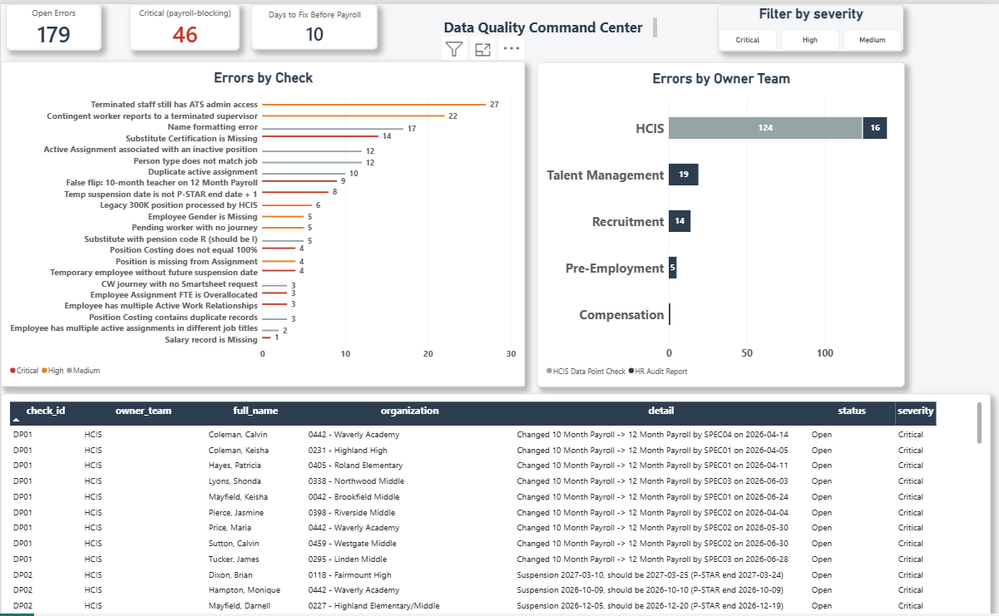
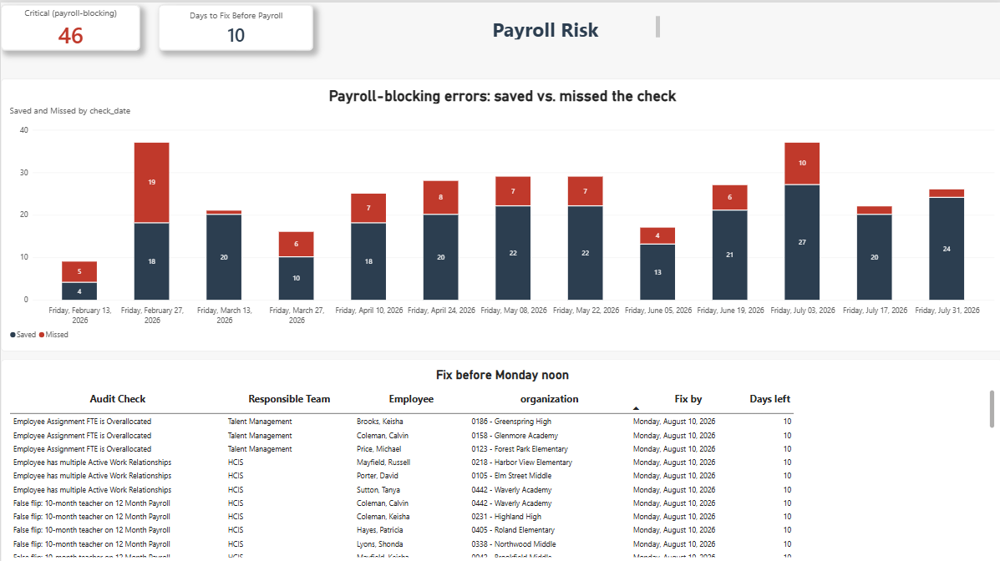
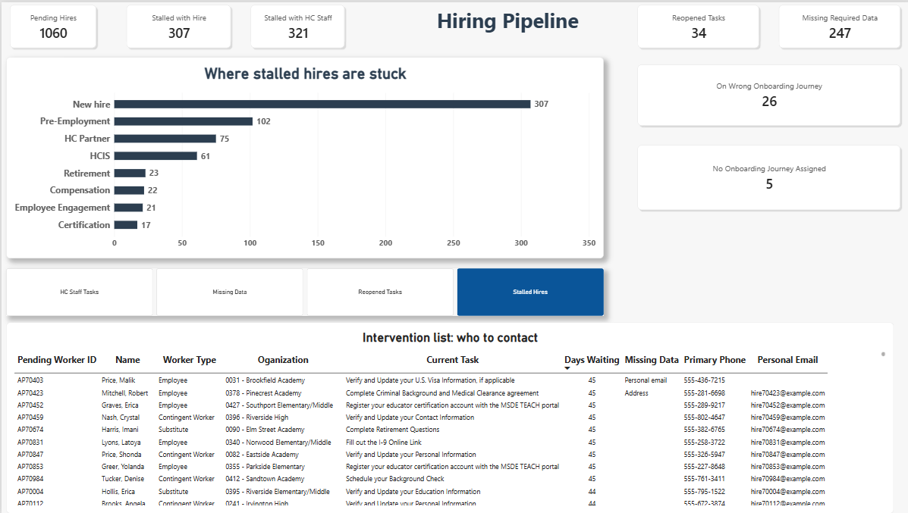
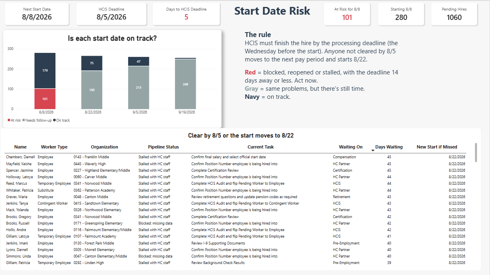

# HR Data Quality & Operations Platform

An end-to-end HR data pipeline for a fictional 13,000-employee school district, "Harbor City Public Schools." Messy exports from the HR system, the temp funding system, PowerSchool and Smartsheet go in. Every real data error comes out in one table, routed to the team that owns the fix, tracked week over week, and shown on Power BI dashboards.

Modeled on the weekly HR audit work I ran as HRIS Supervisor after an Oracle Fusion HCM go-live. **All data is synthetic.** No real people or records are used.

## The problem

Every week the HR Audit Report listed thousands of rows. Most were known exceptions that showed up no matter what: mass items waiting on a bulk fix, or the same handful of people on special leave. The real work was the 20 to 70 errors underneath: sort them by team, compare this week to last week, and chase the ones that block payroll. Some errors only show up when you compare two systems, which no single report does.

## What it covers

| Layer | What it is | Size |
| --- | --- | --- |
| HR Audit Report | 26 weekly runs (Feb to Jul 2026), 25 numbered audit messages, 6 owner teams | 19 to 68 action items a week |
| Known Exceptions log | Messages that showed up every week regardless, kept in their own table | about 4,600 rows a week |
| HCIS Data Point Checks | 11 cross-system checks I built myself, written in SQL | 124 errors |
| Hiring pipeline | 1,060 pending workers on the 4 real pre-boarding journey templates, with planned start dates | 16,649 journey tasks |
| Payroll calendar | Biweekly pay periods 13 to 33: HCIS deadlines, timecard close, Monday-noon error fix-by, payroll run, check date | 21 pay periods |

## How it works

1. `generate_data.py` creates the fake exports with errors planted on purpose, plus an answer key.
2. `sql/01_load_raw.sql` loads every export into PostgreSQL exactly as received.
3. `sql/02_staging.sql` cleans them: three date formats, zero-padded IDs, stray spaces, Oracle's 4712-12-31 end date, audit messages like "6. Substitute Certification is Missing".
4. `sql/03_audit_checks.sql` builds the audit layer:
   - tags every audit row with its check, severity and owner team
   - separates known exceptions into their own log, so the dashboard shows only real work
   - compares each weekly run to the one before: **New, Still Open, Resolved**
   - keeps a history per error: first seen, last seen, resolved date
   - runs the 11 Data Point Checks against the roster
   - counts down to the next payroll fix-by and tracks payroll-blocking errors **saved vs. missed** each pay period
   - proves every count matches the answer key
5. `sql/04_pipeline.sql` builds the hiring pipeline:
   - finds the task each new hire's journey is stuck on, and whether it's waiting on the hire or on HC staff
   - rebuilds the four tabs of the hiring intervention dashboard: stalled with the hire, stalled with HC staff, reopened tasks, missing data
   - flags hires on the wrong journey for their worker type
   - counts down to the next HCIS processing deadline; a hire who misses it moves to the next pay period
6. Power BI reads the `audit` tables (Dashboard A) and the `pipeline` tables (Dashboard B).

`run_all.bat` runs all of it in one click.

## Results (latest run, 7/31/2026)

| Source | Open | By team |
| --- | --- | --- |
| HR Audit action items | 55 | Talent Management 19, HCIS 16, Recruitment 14, Pre-Employment 5, Compensation 1 |
| HCIS Data Point Checks | 124 | Terminated staff with ATS admin access 27; CWs under a terminated supervisor 22; name formatting 17 |
| Known exceptions (own log) | 4,598 | Mostly mass items fixed by bulk update, plus 10 people on special leave or international status |
| Hiring pipeline | 1,060 pending hires | Stalled with the hire 307, stalled with HC staff 321, reopened 34, missing data 247 (909 intervention rows); 26 on the wrong journey; 39 district office hires |

**Payroll:** as of 7/31/2026, 46 payroll-blocking (Critical) errors are open with 10 days to the next fix-by (Monday 8/10, check date 8/14). Payroll-blocking errors that missed a check fell from 19 in pay period 17 to 2 by pay period 28.

**Next start date:** 280 hires start 8/8/2026. The HCIS processing deadline is 8/5, 5 days out, and 101 of them are blocked, reopened or stalled. Any not cleared by then start 8/22 instead.

Every check matches the planted answer key in `data/answer_key.csv`.

## Dashboard










## How to run it

Requires Python 3 and PostgreSQL. No Python packages needed.

```
psql -U postgres -c "CREATE DATABASE hr_portfolio;"
run_all.bat
```

Or step by step:

```
python generate_data.py
psql -U postgres -d hr_portfolio -f sql/01_load_raw.sql
psql -U postgres -d hr_portfolio -f sql/02_staging.sql
psql -U postgres -d hr_portfolio -f sql/03_audit_checks.sql
psql -U postgres -d hr_portfolio -f sql/04_pipeline.sql
```

New to the code? Read `docs/HOW_IT_WORKS.md`. To run, rebuild or explain the whole project, see `docs/PROJECT_MANUAL.md`.

## Tech

Python (standard library) · PostgreSQL · SQL (CTEs, window functions, anti-joins, regex) · Power BI

## Next

- Team operations dashboard: partner submission quality, queue aging
- AI-drafted outreach notes for each error, with human approval
